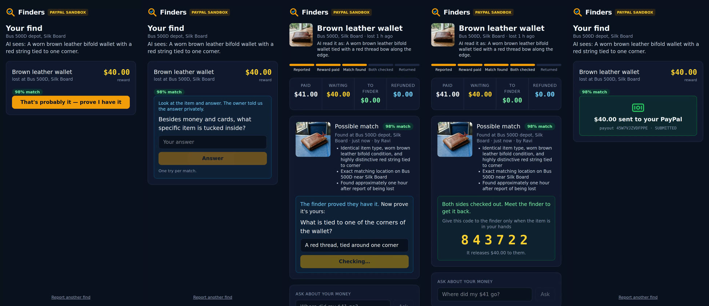
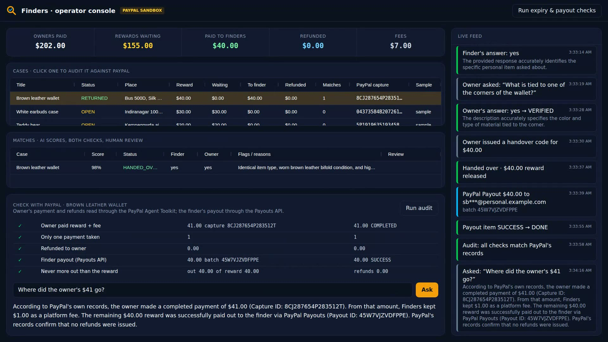

# Finders

**Lost something? Post a reward. Found something? Get paid for returning it.**

Dev left his wallet on a Bengaluru bus. The conductor found it but has no way to reach him, and no reason to try.
With Finders, Dev posts a $40 reward and pays it into PayPal up front. The conductor photographs the wallet. The AI
matches the photo to Dev's report. It asks the conductor something only the person holding the wallet could answer,
and asks Dev something only the owner would know. Dev gets his wallet back and gives the conductor a six-digit code.
The code releases the $40 to the conductor's PayPal.



**Demo video (1:37):** [docs/finders-demo.mp4](docs/finders-demo.mp4) · YouTube link added at submission

> PayPal **sandbox** only: no real money moves. Sample reports on the board are marked "sample". The demo item
> photos in `demo/photos/` were generated with Gemini's image model.

## How a case works

| Step | AI (Gemini via the Nexura Agents SDK) | PayPal (sandbox REST APIs) |
|---|---|---|
| Owner reports a loss | Reads the text and optional photo into attributes: type, brand, colours, marks, contents | — |
| Owner pays the reward | — | **Orders v2, `intent=CAPTURE`** for reward + $1.00 fee, via the PayPal button (JS SDK) or a sandbox card |
| Someone reports a find | Reads the finder's photo the same way | — |
| Match | Code first drops cases outside the time window and items of a different type. Gemini then scores the rest with reasons ("red thread tied to one corner; found 2 h later on the same route"). Only strong scores are proposed | — |
| Finder proves it | Writes a question from the owner's **private** detail ("What is tucked inside the change compartment?"), then judges the answer. A guard stops any question that would give the secret away | — |
| Owner proves it | Writes a question about something visible in the finder's photo but missing from the owner's public report ("What is tied to the edge of the wallet?") | — |
| Handover | Owner gets a 6-digit code once they have the item, and may lower the reward if it came back damaged | — |
| Pay the finder | — | **Payouts v1** to the finder's PayPal email. `sender_batch_id` = settlement id, one payout per case; the item status is tracked until SUCCESS |
| Reduced reward | — | **Refund** of the difference against the owner's capture |
| Nothing found in 14 days, or owner cancels | — | **Refund** of the reward (the $1 fee is kept) |
| Audit | Gemini answers "Where did my $41 go?" with read-only tools | Ledger checked against PayPal's records: the owner's order through the **PayPal Agent Toolkit** (`get_order_details`), the payout through the Payouts API |

Why the reward is captured up front rather than authorized: a lost item can take longer to turn up than an
authorization's 3-day honour period ([PayPal docs](https://developer.paypal.com/payment-methods/auth-honor/)).
Refunds cover every outcome where the finder is not paid.



## Safety rules

- **The AI never moves money.** Code moves it, and only on one of three triggers: a correct handover code, an
  expiry, or the owner cancelling.
- **One payout per case**, enforced by a unique database index and by PayPal refusing a repeated `sender_batch_id`.
  A lost payout response is never resent as a new payout.
- **Every PayPal call is written to the database before it is sent**, with its idempotency id. After a crash or a
  timeout, the server resends with the same id. It never resends with a new one.
- **The owner's private detail is never shown.** The AI only uses it to check the finder's answer.
- **The finder gets one try per match.** A wrong owner answer goes to a person for review, not to automatic
  rejection: the owner already paid, and real owners forget details.
- **A person reviews the payout first** when a fraud rule fires: a photo reused from another report, or more than
  3 verified claims by one finder in 24 hours.
- **A payout counts as "paid" only when PayPal's item status is SUCCESS.** UNCLAIMED and PENDING stay visible.
- **Pending is not paid.** An owner payment that PayPal reports as PENDING does not put the reward on offer until it
  completes, and a declined one closes the case. A PENDING refund is shown as pending until it completes.
- **Lost responses recover the original.** If the first payout attempt's response was lost, PayPal's
  duplicate-batch error links to the original batch, which is then tracked. Without that link, a person reviews it.
- **Wrong handover codes lock after 5 tries.** The owner can issue a new one.
- **Sandbox only.** The REST client and the toolkit reader refuse any other host.

## AI used

- **Gemini `gemini-3.8-flash`** through the [Nexura Agents SDK](https://pypi.org/project/nexura-agents/), with typed
  (Pydantic) outputs and photo attachments. It describes items, ranks candidates, writes both verification questions,
  judges answers, and answers money questions with read-only tools.
- **Gemini `gemini-3.1-flash-image`** generated the demo photos (`scripts/gen_images.py`).
- **Without a Gemini key**, Finders runs on simple keyword rules. These are clearly weaker and are labelled "rules (no
  model)" in the UI.

## Run it

You need:

- Python 3.12+ and [uv](https://docs.astral.sh/uv/)
- Node 22+
- a PayPal sandbox REST app
- optionally, a Gemini API key

```bash
cp .env.example .env                      # fill in PAYPAL_CLIENT_ID, PAYPAL_CLIENT_SECRET, GEMINI_API_KEY, FINDERS_OPERATOR_KEY
uv sync
(cd web && npm ci && npm run build)
uv run python scripts/seed_demo.py finders.db    # optional: 6 sample reports, paid with the sandbox card
uv run python -c "from finders.api import main; main()"
```

Then open these pages. For the demo, use two phones or two browser profiles: one for the owner, one for the finder.

- http://127.0.0.1:8078: home and the board of open rewards
- `/lost`: owner flow
- `/found`: finder flow
- `/ops`: operator console (AG Grid, live feed, review queue, PayPal audit)

Try it with the demo photos:

1. **Owner** (`/lost`): report "Brown leather wallet". As the private detail, enter "a small photo of my daughter in
   the coin pocket". Optionally attach `demo/photos/wallet_owner.jpg`. Pay with the PayPal button (sign in as a
   sandbox Personal account) or the test card.
2. **Finder** (`/found`): upload `demo/photos/wallet_found.jpg`. Enter a sandbox Personal account's email as the
   PayPal email. Tap the match and answer the question.
3. **Owner:** answer your question, then tap "I have it back" and read out the code.
4. **Finder:** enter the code. The payout appears, and the operator console shows every step.

Other commands:

- `uv run pytest`: run the tests (34, against a local fake PayPal and a scripted AI)
- `uv run python scripts/live_case.py /tmp/live.db demo/photos/keys_found.jpg`: run a whole case against the real
  sandbox and Gemini from the command line

Deploy: `Dockerfile` (one container: API + web) and `render.yaml`. Set the secrets in the host's dashboard.

## Limits

- Sandbox only. Running Finders for real means holding rewards for strangers. That needs PayPal's approval for
  Payouts and, depending on the country, a money-transmission licence or a partner that holds funds. Finders would
  run as a disclosed reward service with its fee shown.
- AI matching has only been tried on a small set of demo items. False matches are limited by the two-sided
  questions and the handover code, not by the score alone.
- No chat between owner and finder. Arranging the meeting is out of scope, and so is the handover itself.
- SQLite and a single server process.
- Webhooks are not used yet. Payout status is polled.

## Licence and credits

Apache-2.0 (see `LICENSE`). PayPal Agent Toolkit by PayPal (Apache-2.0). AG Grid Community (MIT). Demo photos
generated with Gemini. Built by Liceron for the PayPal AI Hackathon 2026.
